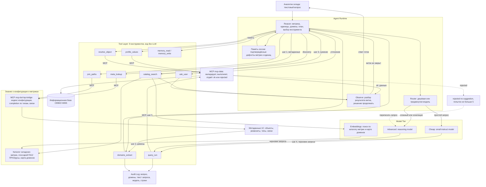
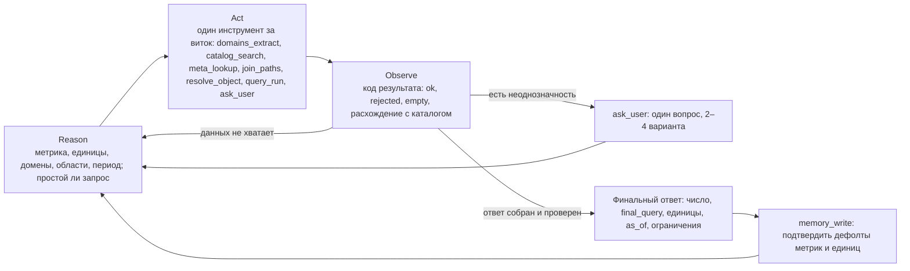
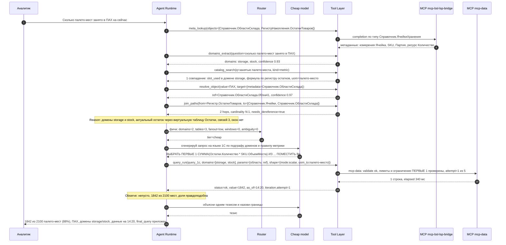
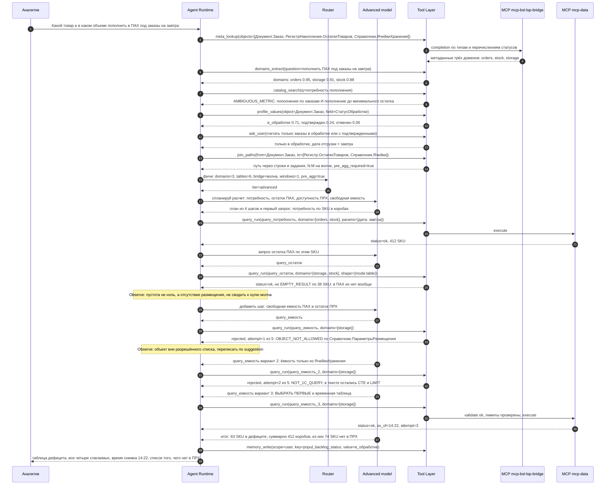
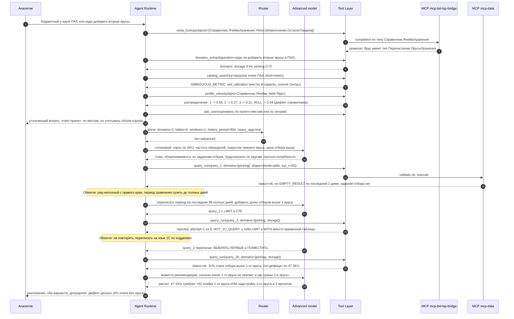
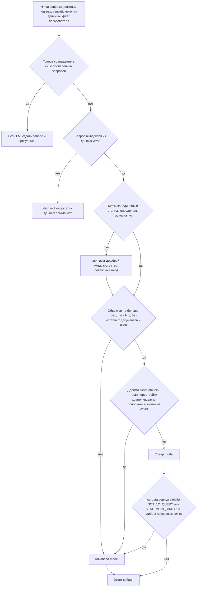
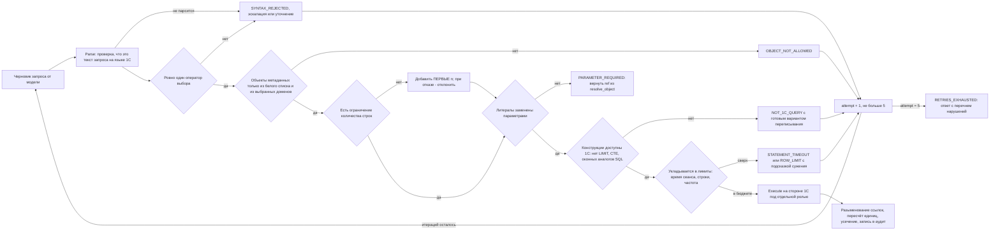

# Кейс 2. Агент аналитики данных: текстовый запрос к СЕВКО WMS на 1С

> Название курса — «Text-to-SQL». Здесь тот же класс задачи, но язык запроса — не SQL, а язык запросов 1С: он единственный, чем эта платформа отдаёт остатки и обороты.

## 1. Паспорт кейса

| | |
|---|---|
| 🧩 **Проблема** | Доступ к данным склада идёт через ручные запросы к СЕВКО WMS: чтобы узнать загрузку ПАХ, простои сборщиков или потребность в пополнении, аналитик идёт к человеку, который знает метаданные конфигурации и виртуальные таблицы остатков. Вопрос «корректный у меня ПАХ или надо добавлять вторые ярусы» превращается в полдня переписки и ручной работы. |
| ⚙️ **Почему нужен агент** | Вопрос задаётся на естественном языке, но требует многошагового рассуждения: понять метрику и её единицы → найти объекты конфигурации и легальный путь связей → собрать корректный запрос → проверить безопасность и непустоту результата → объяснить вывод. Это устойчивая повторяемая процедура с понятной точкой выхода — работа для агента, а не для чата. |
| 🤖 **Что делает** | Принимает текстовый запрос → через MCP `mcp-bsl-lsp-bridge` вытаскивает метаданные конфигурации 1С → по ним выделяет из запроса домены и формирует запрос на языке запросов 1С → MCP `mcp-data` валидирует и выполняет → агент объясняет результат числом, таблицей и текстом. |
| 🔒 **Ограничения** | Пользователи агента — аналитики склада с **полным доступом на чтение** ко всем данным WMS: многоуровневой изоляции по владельцам груза нет и не требуется. Защита строится на другом: только чтение, защита производительности сервера 1С, лимиты объёма и обязательная валидация до выполнения. |
| ⚠️ **Сложности** | Терминология и единицы («остатки» — штуки, коробки или палето-места; «занятость» — смена или время между операциями), связи между объектами 1С (ссылочные типы, мостовые документы, виртуальные таблицы), ограничения языка запросов 1С и цена ошибки при обращении к рабочей базе. |

## 2. Домен: СЕВКО WMS на платформе 1С:Предприятие 8

WMS живёт внутри конфигурации на платформе 1С, и это не «ещё одна БД со своей схемой». Модель данных платформы задаёт свои правила игры.

| Конструкция 1С | Что это для агента |
|---|---|
| Метаданные конфигурации (справочники, документы, регистры, группы свёрток) | настоящие таблицы — это представление над объектами метаданных; имена таблиц вида `Catalog178`, `AccumRg305`, а осмысленные имена живут только в метаданных. Знать схему означает знать конфигурацию |
| Ссылочные типы (`СправочникСсылка.Номенклатура`) | в GROUP BY и JOIN участвуют ссылки-UUID, а не подписи; выборка «наименование + код» требует явного разыменования |
| Виртуальные таблицы (`РегистрНакопления.ОстаткиТоваров.Остатки(...)`, `Обороты(...)`, `КонечныйОстаток()`) | остатки и обороты — не строки таблицы, а вычисление движка 1С на момент запроса; получить их можно только языком запросов 1С |
| Язык запросов 1С | не SQL: `ВЫБРАТЬ ПЕРВЫЕ n` вместо `LIMIT`, `ПОМЕСТИТЬ`/временные таблицы вместо CTE, `ИТОГИ`, `РАЗРЕШИТЬПОСТРОЧНОЕДОБАВЛЕНИЕ`; свои функции дат и работы со ссылками |
| Режим работы базы | файловый / клиент-серверный. Для агента разницы нет: единственный путь к данным — запрос через `mcp-data`, как устроено выполнение внутри — его внутреннее дело |
| Права на уровне платформы | доступ задаётся ролью пользователя 1С, а не policies в СУБД. Точка применения ограничений — сама платформа |

**Складская терминология, на которой сформулированы реальные запросы** (в конкретной ИБ объекты могут называться иначе — см. §17):

| Термин | Что означает | Где лежит |
|---|---|---|
| **ПАХ** | зона активного комплектования: ячейки, из которых товар берётся в заказ | справочник ячеек + область/зона склада |
| **ПРХ** | зона хранения-резерва, источник пополнения ПАХ | то же, другая область |
| **Ярус ячейки** | этаж стеллажа; 1-й ярус — отбор без техники, выше — требуется погрузчик | атрибут ячейки или часть адреса |
| **Область склада** | крупное деление (ЕвроПаллеты, Китай, штучный отбор) | справочник областей/зон |
| **Вместимость ячейки** | лимит в палето-местах, коробах или литрах | реквизиты ячейки и габариты номенклатуры |
| **Волна, задание на отбор, пополнение** | документы-исполнители операций | документы и движения регистров |

## 3. Пользователи и границы доступа

**Аудитория: аналитики склада с полным доступом на чтение ко всем данным WMS.** Отсюда три разводящих вывода:

1. **Изоляция по владельцам груза не спроектирована и не нужна.** RLS-предикатов в запросах нет, `resolve_object` не фильтрует по принадлежности. Это снимает целый слой сложности, который был бы обязателен для 3PL-оператора, но не для собственного склада сети.
2. **Главный риск — не утечка, а доступность сервера.** Один неосторожный агрегат по регистрам движений на рабочей базе способен затормозить приёмку и комплектацию. Поэтому защита производительности — первичное требование к контуру выполнения (§14), а не второстепенная оптимизация.
3. **Полный доступ на чтение не равен произволу.** Агент работает под выделённой ролью 1С с правами только на чтение и только на разрешённые объекты метаданных, а не под учётной записью конкретного аналитика: права человека шире, чем нужно агенту, и в аудите должно быть видно, кто задал вопрос, а какие права фактически использовались.

Отдельно: **агент не является инструментом аудита сотрудников.** У него полный доступ к данным о перемещениях и операциях персонала, и запрос «занятость» обслуживается, а запрос «накажите Иванову за простой 40 минут» — нет: агент выдаёт измерение и распределение, но не оценки о людях (§4, non-goals).

## 4. Прикладной сценарий: четыре задачи реального аналитика

Формулировки взяты от аналитика склада — они и определяют, какие инструменты и метрики нужны.

### Задача 1. Корректный ли ПАХ, нужны ли вторые ярусы

> «Ячейки он видит, понять это 1-й ярус или 2-й, тоже может»

Аналитик может глазами посмотреть на структуру ячеек, но не может без запроса ответить, **хватает ли ёмкости 1-го яруса** под фактическое потребление. Что нужно посчитать:

| Шаг | Данные | Вывод |
|---|---|---|
| 1 | объём потребления по SKU за период (строк отбора, коробов, вес) | частота обращений к SKU |
| 2 | текущие остатки в ПАХ в штуках/коробах и вместимость ячеек 1-го яруса | покрытие спроса без пополнения |
| 3 | доля строк отбора, выполненных выше 1-го яруса, и трудозатраты на них | цена нехватки нижнего яруса |
| 4 | оборачиваемость и страховой запас | сколько SKU реально требует 2-го яруса, а сколько — расширения нижнего |

Ответ агента — не «да/нет», а **разложение**: X% строк отбора уже идёт выше 1-го яруса, это N SKU с долей отбора M%, при таком спросе нужно +K ячеек 1-го яруса или +L ярусов в существующих пролётах.

### Задача 2. Корректно ли товар разделён по областям склада (ЕвроПаллеты / Китай)

Аналитику нужны справочник номенклатуры и распределение ячеек по областям — чтобы проверить гипотезу «крупногабаритное лежит там, где должно, а мелкоштучное — тоже». Проверка:

| Признак | Ожидаемая область | Факт | Отклонение |
|---|---|---|---|
| Тип упаковки = цельная палета, высокий разовый отбор | ЕвроПаллеты | ячейка в «Китай» | раздувает трудозатраты и место |
| Мелкоштучный отбор, малый объём, высокая частота строк | Китай (штучный отбор) | палетная ячейка в ЕвроПаллетах | собирают с палеты по одной коробке |
| Габарит/вес не влезает в ячейку области | переместить | остаток размещён «как влезло» | риск пересорта |

Инструментально это сравнение **двух распределений**: фактического (где лежит) и нормативного (где должно лежать по признакам номенклатуры и профилю отбора). Норматив задаётся каталогом правил размещения, а не догадкой модели.

### Задача 3. Занятость сотрудников

Здесь один вопрос оборачивается четырьмя разными метриками, и они берутся из разных объектов:

| Подвопрос | Метрика | Источник в WMS |
|---|---|---|
| сколько времени был в работе | суммарное время операций, покрытые смены | регистры трудозатрат по заданиям |
| сколько заказов и приёмок сделал, какой объём и вес обработал | количество заданий/документов, суммарные объём и вес через габариты номенклатуры | документы операции + движения + нормативы веса и объёма SKU |
| простой: когда и максимальные промежутки | распределение интервалов между соседними операциями, top-N интервалов, доля времени между началом и концом смены | таймстемпы операций |
| пришёл / ушёл | границы сессии и табельное время | сеансы, журнал регистрации, учёт рабочего времени |

Ловушка, которую обязан увидеть агент: **«в работе» ≠ «в смене»**. Время между сканами может быть ожиданием задания, а может паузой на обед; без разделения получаем фиктивные 40% простоев. Поэтому метрика в каталоге хранит определение интервала и признак «ждать-нельзя-считать-простожем».

### Задача 4. Какой товар и в каком объёме нужен для ручного пополнения ПАХ

> «Заказы на завтра есть в обработке — остатки он видит и по ПАХ, и по ПРХ»

Ключевая задача, и она самая глубокая по циклу:

1. взять **необоснованно подтверждённые заказы на завтрашнюю дату** (в обработке, не отменённые);
2. посчитать **потребность** по SKU и единицам (короба/штуки) с разбивкой по зоне отбора;
3. взять **фактический остаток в ПАХ** на текущий момент (виртуальная таблица остатков с фильтром по области);
4. взять **доступный остаток в ПРХ** и свободные ячейки в ПАХ (вместимость минус занятость);
5. вывести `потребность − остаток_ПАХ = дефицит`, ограниченный `остаток_ПРХ` и `свободная ёмкость ПАХ`, округлённый до кратной единицы (короб/палета).

Ответ обязан показать **все четыре слагаемых**, а не только цифру дефицита: иначе аналитик не сможет проверить, что агент не перепутал статусы резервирования.

### Классы запросов и non-goals

| Класс | Пример из задач | Глубина цикла | Модель |
|---|---|---|---|
| Точечная цифра | «сколько сборщиков в смене с 8:00», «остаток SKU X в ПАХ» | 1–2 витка | дешёвая |
| Срез/топ | «ТОП-10 SKU по объёму отбора за неделю», «простои за месяц» | 2–3 витка | дешёвая |
| Диагностика и нормативы | задачи 1, 2, 4 | 4–6 витков, несколько запросов | продвинутая |

**Non-goals (агент сознательно не делает):**
- не пишет в базу: ни документов, ни движений, ни изменений справочников — только чтение;
- не меняет адреса хранения и не формирует задания на пополнение — он **считает потребность**, решение и запуск остаются за человеком;
- не оценивает персонал: выдаёт измерение времени и выработки, но не выводы о дисциплине конкретных людей;
- не считает финансы (себестоимость, тарифы, выручку) — этих данных в WMS нет;
- не отвечает, если не смог связать запрос хотя бы с одним объектом метаданных: вместо догадки уходит в уточняющий вопрос.

## 5. Подключение к 1С: два MCP-сервера

| MCP | Что даёт | Чем именно |
|---|---|---|
| **`mcp-bsl-lsp-bridge`** ([SteelMorgan/mcp-bsl-lsp-bridge](https://github.com/SteelMorgan/mcp-bsl-lsp-bridge)) | **метаданные конфигурации 1С**: объекты, реквизиты, типы, перечисления, подсистемы, связи | `project_analysis`, `symbol_explore`, `completion` (Type System v2), `hover`, `call_hierarchy`, `document_diagnostics` |
| **`mcp-data`** (наш) | **запрос и данные**: принимает текст запроса на языке запросов 1С, валидирует, выполняет, отдаёт результат или типизированную ошибку | контракт: `query_run(query_1c, params, shape)` → `ok` / `rejected` |

Устройства `mcp-data` этот документ не касается: чем внутри реализовано выполнение — его внутреннее дело. Агент знает только контракт и коды ошибок (§7.3).

| Инструмент (§7.2) | Обслуживает |
|---|---|
| `meta_lookup`, `join_paths` | `mcp-bsl-lsp-bridge` |
| `query_run`, `profile_values`, `resolve_object` | `mcp-data` |
| `domains_extract`, `catalog_search`, `ask_user`, `memory_read` / `memory_write` | рантайм агента по карте доменов каталога и индексу `mcp-bsl-lsp-bridge` |

Агент не имеет прямого доступа ни к базе 1С, ни к её СУБД — только через эти два MCP. Серверу метаданных доступ к данным не нужен.

## 6. Компонентная архитектура



### 6.1 Порядок работы: сначала метаданные, потом домены, потом запрос

Логика, на которой держится вся архитектура, в пять шагов:

1. **Вытянуть метаданные из 1С** через `mcp-bsl-lsp-bridge`: какие в этой конфигурации есть объекты, реквизиты, типы, перечисления и связи.
2. **По метаданным выделить из вопроса домены** — предметные области склада, к которым он относится: остатки, отбор, персонал, заказы, ёмкость хранения. Домен не выдумывается: это подсистема или группа объектов из того же индекса конфигурации.
3. **Сузить будущий запрос до выбранных доменов**: candidate subgraph строится только из объектов этих доменов, а не из сотен объектов конфигурации целиком. Именно здесь «сколько сейчас лежит в ПАХ» превращается в конкретные регистры и справочники.
4. **Сформировать запрос на языке запросов 1С** по подграфу и правилу метрики из каталога.
5. **Отдать запрос в `mcp-data`** — тот валидирует и выполняет. Не прошёл валидацию → типизированная ошибка с подсказкой, агент переписывает запрос и пробует снова. **Итераций не больше пяти**: после пятой — ответ с явным перечнем непоправленных нарушений.

| Шаг | Чем выполняется | Провал шага |
|---|---|---|
| 1. Метаданные | `meta_lookup`, `join_paths` через `mcp-bsl-lsp-bridge` | `UNKNOWN_OBJECT` → уточнить, а не угадывать |
| 2. Домены | `domains_extract` по метаданным и карте доменов | `UNKNOWN_DOMAIN` → `ask_user` |
| 3. Сужение | `catalog_search` + `join_paths` по выбранным доменам | `NO_JOIN_PATH` → сузить или честно отказать |
| 4. Генерация запроса | модель того яруса, который выбрал Router | `NOT_1C_QUERY` — это нарушение на шаге 5, а не на шаге 4: модель вправе ошибиться в синтаксисе, запрос всё равно не пройдёт мимо `mcp-data` |
| 5. Валидация и выполнение | `query_run` → `mcp-data` | `SYNTAX_REJECTED`, `OBJECT_NOT_ALLOWED` → следующая из 5 итераций |

Три следствия, которые стоит держать в голове:

- **Модель не видит конфигурацию целиком.** Она видит фрагмент метаданных выбранных доменов. Это экономит контекст дешёвой модели и снимает главную ошибку Text-to-SQL на 1С — ссылки на реквизиты, которых не существует.
- **Домены — якорь неоднозначности.** «Занятость» и «простой» относятся к разным доменам (персонал против операций), поэтому разделение происходит до генерации запроса, а не после.
- **Пять итераций — бюджет `mcp-data`, а не пожелание.** Счётчик попыток живёт в контракте инструмента (`iteration.attempt`), его нельзя «забыть» ни модели, ни рантайму.

### 6.2 Компоненты

| Компонент | Ответственность | Ключевое свойство |
|---|---|---|
| Agent Runtime | ведёт цикл Reason → Act → Observe, хранит историю витков | конечный автомат с лимитом витков |
| Router | выбирает модель и бюджет витка | чистая функция от фичей запроса, логируется |
| Tool Layer | все действия агента над внешним миром | детерминирован, валидирует ввод от LLM, типизированные ошибки |
| Model Tier | только генерация текста и черновика запроса | не имеет прямого доступа к базе |
| Каталог метрик и карта доменов | единое определение занятости, простоя, потребности в пополнении, единиц; привязка терминов к доменам | снимает основную часть неоднозначностей |
| MCP `mcp-bsl-lsp-bridge` | знание о конфигурации: объекты, реквизиты, типы, связи | источник истины для метаданных; индекс по исходникам, а не по ИБ |
| MCP `mcp-data` | выполнение запросов к 1С: валидация, лимиты, выполнение, формат ответа | единственная точка входа к данным; до 5 итераций правки запроса |
| Audit Log | трассируемость «цифра ← домены ← запрос ← MCP ← вопрос ← пользователь» | пишется средним слоем, а не по воле модели |

Принципиально: **LLM не подключается к 1С напрямую**. Модель предлагает текст запроса, а проверяет, ограничивает и выполняет его `mcp-data`. Из двух MCP-серверов доступ к данным имеет только `mcp-data`; `mcp-bsl-lsp-bridge` видит исключительно исходники конфигурации и потому не может ничего прочитать из ИБ.

## 7. Инструменты агента

Инструмент — действие, которое модель **может выбрать сама**. Всё, что должно происходить **всегда**, инструментом не является: иначе модель получит право его пропустить.

### 7.1 Что не стало инструментами

| Обязанность | Где живёт | Почему не tool |
|---|---|---|
| Ведение цикла: сколько витков пройдено и пора ли останавливаться | конечный автомат рантайма | модель не считает свои же шаги — она их забывает |
| Валидация запроса перед выполнением | внутри `mcp-data` | пропуск = дыра; у модели нет права «выполнить без проверки» |
| Ограничения времени и строк | внутри `mcp-data` | лимиты задаёт исполнитель, а не тот, кто просит |
| Аудит каждого ответа | middleware рантайма по всем виткам | обязанность, а не стратегия |
| Роутинг моделей | `Router`, вызывается рантаймом | решение о затратах не отдаётся генерирующему звену |
| Кэш проверенных запросов | middleware до `Reason` | иначе модель перечитывает кэш как виток и тратит бюджет |
| Бюджет итераций правки запроса | контракт `mcp-data` (`iteration.attempt`, максимум 5) | самоограничение модели не работает |
| Пересчёт единиц (шт → короб → палето-место) | `mcp-data` при форматировании по коэффициентам номенклатуры | арифметику габаритов доверять LLM нельзя |
| Разыменование ссылок 1С (UUID → наименование) | `mcp-data` при форматировании ответа | механическая подстановка, не рассуждение |

Единственное, что поначалу выглядело как обязанность рантайма, но стало инструментом — извлечение доменов. Пока оно было «рассуждением Reason», его нельзя было ни проверить, ни залогировать, ни измерить (§16), поэтому появился `domains_extract`: он читает те же метаданные, что и `meta_lookup`, а модель только формулирует вопрос.

### 7.2 Поверхность инструментов (v1)

Восемь инструментов модель выбирает свободно, девятый (`query_run`) — единственный путь к данным. Первый инструмент работает по метаданным: он превращает текст вопроса в домены конфигурации.

```ts
// ── Шаг 2: из вопроса и метаданных выделяем домены ─────────────────────
domains_extract(question: string, metadata_refs?: string[], top_k?: 1..6)
  -> domains: [{ name, objects: string[], confidence, evidence }]
  // «занятость сотрудников» -> personnel_ops, work_time;  «палето-места в ПАХ» -> storage, stock
  // домены берутся из индекса конфигурации mcp-bsl-lsp-bridge (подсистемы, группы объектов)

// ── Discovery: снимаем неоднозначность до генерации запроса ────────────
catalog_search(q: string, kind?: "metric" | "dimension" | "term" | "domain", top_k?: 1..10)
  -> matches: [{ id, canonical_name, definition, formula, uom: ("шт"|"короб"|"палето-место"|"л"|"кг"|"час")[],
                 domain, source: { object_1c }, synonyms[], confidence }]
  // «занятость» -> busy_time, on_shift_time, idle_gap_time: три разные метрики
  // «остатки»   -> stock_qty по областям, со статусами и в разных единицах
  // гибрид: embeddings + BM25 по каталогу метрик и глоссарию складских терминов

meta_lookup(objects: string[], detail?: "summary" | "full")
  -> objects: [{ metadata_name, technical_table, kind: ("Catalog"|"Document"|"Accumulation"|"Information"|"Constant"),
                 dimensions[], resources[], attributes: [{ name, type, ref_to?, enum_values? }],
                 virtual_tables?: ["Остатки","Обороты","СрезПоследних"], row_count_estimate, last_modified }]
  // метаданные отдаёт MCP mcp-bsl-lsp-bridge: completion по типам, symbol_explore, hover
  // отдаёт только те объекты, что попали в выбранные домены, а не всю конфигурацию

join_paths(from: string, to: string[], max_hops?: 1..4)
  -> paths: [{ hops: [{ left, right, on: "<Ссылка> = <Ссылка>", via?, cardinality: "1:1"|"1:N"|"N:M" }],
               needs_dereference: boolean,   // потребуется ли связка с реквизитом справочника
               fanout_risk, pre_agg_required }]
  // заказ -> строка -> задание -> сотрудник: через мостовые документы, N:M на волне
  // строится по типу ссылочных реквизитов из mcp-bsl-lsp-bridge, а не по SQL-внешним ключам

profile_values(object: string, field: string, sample_n?: 1..20)
  -> { distinct_count, null_rate, min, max, top_values: [{ value, label, share }],
       formats?, last_updated }
  // Справочник.ОбластиСклада -> ["ЕвроПаллеты" 0.62, "Китай" 0.31, "Несортированные" 0.07]
  // Справочник.ЯчейкиХранения.Ярус -> распределение ярусов и сколько ячеек вообще без яруса (это дефект данных)

resolve_object(value: string, target: { metadata: string, by?: ("name"|"code"|"article")[] }, top_k?: 1..5)
  -> candidates: [{ ref, uuid, presentation, code, confidence, alternatives[] }]
  // "ЕвроПаллеты" -> Справочник.ОбластиСклада.<uuid>; "1Э4Ф" -> Справочник.ЯчейкиХранения.<uuid>
  // возвращает ССЫЛКУ 1С, а не строку: дальше она уходит как параметр, а не как литерал

// ── Взаимодействие и память ────────────────────────────────────────────
ask_user(question: string, options: [{ label, meaning, default? }], due_to: string)
  -> { choice | free_text, remembered: boolean }
  // жёстко: один вопрос, 2–4 варианта, ссылка на причину неоднозначности

memory_read(scope: "session" | "user", prefix?: string) -> entries: [{ key, value, ts }]
memory_write(scope: "session" | "user", key: string, value: json, ttl?: "turn"|"day"|"forever") -> { ok }
  // подтверждённые дефолты: uom=короб, статус_заказа=в_обработке, область_отбора=ПАХ

// ── Единственный проход к данным: MCP mcp-data ─────────────────────────
query_run(query_1c: string,                       // только язык запросов 1С
          domains: string[],                      // домены, извлечённые из метаданных
          params?: Record<string, scalar | ref>,  // ref = Ссылка 1С из resolve_object
          dry_run?: boolean,                      // только валидация, без выполнения
          shape?: { mode: "scalar"|"table"|"timeseries"|"comparison"|"distribution",
                    top_n?: number, decimals?: number, dimension?: string,
                    uom_to?: "шт"|"короб"|"палето-место"|"л"|"кг" })
  -> { status: "ok" | "rejected" | "error",
       validation: { checks_passed[], violations?: [{ code, detail, suggestion }] },
       iteration: { attempt: 1..5, budget: 5 },   // сколько попыток уже израсходовано
       columns?: string[], rows?: Row[], row_count, truncated,
       final_query,                                // после дописывания ограничения строк
       as_of,                                      // время снимка оперативных данных
       uom: { requested, applied },
       elapsed_ms }
  // mcp-data валидирует запрос и либо выполняет, либо возвращает типизированную ошибку
  // при rejected агент переписывает запрос по suggestion; попыток не больше 5
```

**Что модель видит в промпте.** JSON-схемы аргументов инструментов, коды ошибок и **кандидатный фрагмент метаданных**, полученный через `meta_lookup`, — но не конфигурацию целиком. В 1С-конфигурации сотни объектов, и полный дамп не влезает в дешёвую модель, а заодно провоцирует ссылки на несуществующие реквизиты.

**Почему `query_run` один, а не `validate` / `execute` по отдельности.** Раздельные инструменты означают, что модель может вызвать выполнение без проверки. Порядок зашит в код `mcp-data` — сломать нельзя, при этом ошибки каждого шага возвращаются раздельно (`validation.violations`, `status`, `iteration`), так что реагировать есть на что.

**Почему валидацию делает `mcp-data`, а не модель.** Цена пропущенной проверки — не неточный ответ, а тормоза на складе или чтение объектов, которых агенту не положено. Модель может сколько угодно считать запрос корректным, но решение о выполнении принимает исполнитель: он проверяет язык, состав объектов и лимиты, а при нарушении возвращает `rejected` с `suggestion`. Переписывание запроса — это итерация, и их максимум пять; на шестой попытке агент обязан остановиться и отдать то, что знает.

**Почему `resolve_object` возвращает ссылку, а не строку.** В 1С фильтровать по наименованию — значит поймать дубли и разные регистры; ссылка уходит как `params`, и в текст запроса пользовательский ввод не попадает вообще.

### 7.3 Модель ошибок: по коду, а не по тексту

| Код | Источник | Что делает Reason |
|---|---|---|
| `NO_CANDIDATE` | `catalog_search` | проверить, не лежит ли вопрос вне WMS; если вне — честный отказ, иначе `ask_user` |
| `AMBIGUOUS_METRIC` | `catalog_search`, `profile_values` | `ask_user` с вариантами и определениями (занятость: смена или операции) |
| `AMBIGUOUS_UOM` | `catalog_search` | `ask_user`: штуки, короба, палето-места, литры; дефолт из памяти |
| `UNKNOWN_OBJECT` | `meta_lookup` | не угадывать имя; `resolve_object` или уточнение |
| `LOW_CONFIDENCE_REF` | `resolve_object` | показать кандидатов в `ask_user`, не брать «наиболее похожий» адрес ячейки |
| `NO_JOIN_PATH` | `join_paths` | сузить запрос или объяснить отсутствие данных; смена яруса модели не помогает |
| `DIAGNOSTICS_MISSING` | `join_paths` (по задаче 2) | честно сказать: норматив размещения не описан в каталоге, вывести только факт |
| `SYNTAX_REJECTED` | `mcp-data` (`validation`) | переписать по `suggestion`, это итерация из 5; повтор той же конструкции запрещён |
| `NOT_1C_QUERY` | `mcp-data` (`validation`) | запрос не на языке запросов 1С (например, `LIMIT` или CTE): переписать на язык 1С |
| `OBJECT_NOT_ALLOWED` | `mcp-data` (`validation`) | объект не входит в разрешённый список метаданных или не относится к выбранным доменам: сузить домены или уйти в `ask_user` |
| `UNKNOWN_DOMAIN` | `domains_extract` | из вопроса не выделен ни один домен конфигурации: уточнить предметную область |
| `STATEMENT_TIMEOUT` | `mcp-data` (выполнение) | сузить период и добавить агрегацию до выборки; тот же запрос не повторять |
| `EMPTY_RESULT` | `mcp-data` (ответ) | проверить фильтр по периоду, области и статусу документа, прежде чем ответить «0» |
| `ROW_LIMIT` | `mcp-data` (ответ) | сказать, что срез усечён, и предложить условие сужения |
| `RETRIES_EXHAUSTED` | `mcp-data` (`attempt=5`) | больше не переписывать: отдать текущий результат с перечнем непоправленных нарушений |
| `BUDGET_EXHAUSTED` | guard рантайма | отдать текущий результат с явной пометкой о неполноте |

### 7.4 Бюджеты инструментов

Лимиты — конфигурация, а не часть промпта.

| Инструмент | Timeout | Относительная цена | Идемпотентен | Частота |
|---|---|---|---|---|
| `domains_extract` | 1 с | низкая | да | ≤ 2 на запрос |
| `catalog_search` | 0,3 с | низкая (эмбеддинги кэшируются) | да | кэш на сессию |
| `meta_lookup` | 2 с | низкая (индекс конфигурации прогрет) | да | 1 вызов на домен за запрос |
| `join_paths` | 2 с | низкая | да | ≤ 3 на запрос |
| `profile_values` | 5 с | средняя | да | ≤ 4 на запрос |
| `resolve_object` | 3 с | средняя | да | ≤ 5 на запрос |
| `ask_user` | ждёт человека | токены не тратит | нет | ≤ 2 на запрос |
| `memory_read` / `memory_write` | 0,1 с | низкая | read — да, write — нет | write ≤ 3 на запрос |
| `query_run` (`dry_run`) | 5 с | низкая: только валидация | да | ≤ 5 на запрос, это и есть бюджет итераций |
| `query_run` (выполнение) | 20 с | **высокая: нагрузка на рабочую базу 1С** | да (чтение) | ≤ 5 итераций на запрос, ≤ 6 витков суммарно |

## 8. Цикл Reason → Act → Observe



| Фаза | Вход | Действие | Выход |
|---|---|---|---|
| **Reason** | текст вопроса + память сессии | извлечь метрику, измерения, период, статусы; `domains_extract` по метаданным определяет домены, `catalog_search` и `join_paths` строят candidate subgraph только внутри них; оценить сложность | план: домены, объекты метаданных, скелет запроса, какой инструмент на следующем витке, фичи для роутера |
| **Act** | план | ровно один инструмент за виток; любой текст запроса идёт только через `query_run`, где валидация `mcp-data` предшествует обращению к базе | артефакт: домены, кандидаты метрик, пути связей, ссылки объектов, черновик запроса, строки, типизированная ошибка |
| **Observe** | артефакт | сверка: статус `ok`, результат непустой, метрика и **единицы** совпали с каталогом, `fanout_risk` не реализовался, `as_of` устраивает, величина правдоподобна относительно справочных сумм | решение: повторить / `ask_user` / ответить |

Правила завершения цикла:
1. не более **6 витков** на диагностический вопрос и 2–3 на точечный; после лимита — честное «не смог» с перечнем препятствий;
2. **один** `ask_user` на виток и не более **двух** на вопрос;
3. типизированная ошибка обязывает сменить план, домены или инструмент, а не повторить тот же вызов; правка текста запроса по `suggestion` — это итерация `mcp-data`, и их отдельный лимит: **не больше пяти**;
4. `EMPTY_RESULT` не трактуется как «нулей и так»: проверяются период, область склада и статус документа;
5. в ответе всегда указываются **единицы измерения, домены и время снимка**: «1 842 палето-места из 2 100, домены storage/stock, данные на 14:20».

## 9. Прогон 1: простой вопрос, весь путь на дешёвой модели

> «Сколько палето-мест занято в зоне отгрузки Химки на сейчас»



Стоимость: 2 вызова дешёвой модели, 6 обращений к инструментам, одна итерация `query_run` из пяти, латентность ~4–7 с, цена — доли цента.

## 10. Прогон 2: задача 4 — потребность в ручном пополнении ПАХ

Здесь нужны и оперативные заказы, и остатки, и ёмкость: несколько запросов к 1С и итерации правки по ошибкам `mcp-data`.



Стоимость: 1 вызов дешёвой + 6 вызовов продвинутой модели, 13 обращений к инструментам, 3 итерации `query_run` из 5, латентность ~60–120 с.

**Что здесь критично для доверия:** агент останавливается на третьей итерации, а не на сотой. Если бы `mcp-data` не считал попытки, правка запроса могла бы повторяться бесконечно, а аналитик получил бы цифру ёмкости из объекта, который ему не показывали. В ответе отдельно названы 74 SKU, которых нет в ПРХ: это не ноль, а отсутствие размещения, и пополнить их нельзя ни в каком объёме.

## 11. Прогон 3: задача 1 — нужны ли вторые ярусы

Диагностика структуры, где главная опасность — неверно посчитать ёмкость.



Агент **не выносит решение** о перестройке: он даёт разложение, цифры и явно называет 4% ячеек без заполненного яруса — без этого любая доля «выше 1-го яруса» считается некорректно. Первая ошибка (`EMPTY_RESULT`) лечится сужением периода, вторая (`NOT_1C_QUERY`) — переписыванием запроса, и это одна из пяти итераций `mcp-data`, а не повод звать человека.

## 12. Этапы, где нужны разные модели

| Этап агента | Какая модель | Почему именно она |
|---|---|---|
| Классификация намерения и извлечение сущностей (метрика, область, период, статус) | Cheap | короткая разметка по стабильному набору тегов, важнее скорость |
| Поиск по каталогу метрик и глоссарию терминов | Embedding model, не LLM | «занятость» ≠ «простой» — семантическое сходство, дёшево и кэшируется |
| Сопоставление названий областей, адресов ячеек, артикулов | Embedding + словарь 1С, не LLM | `resolve_object` — поиск по справочнику, а не рассуждение |
| Формулировка `ask_user` по найденным вариантам | Cheap | шаблонная формулировка, выбора нет |
| Выбор инструмента на витке | Cheap, правила роутера поверх | пространство из 9 инструментов, ошибочный выбор виден по лишнему витку |
| Извлечение доменов из вопроса по метаданным | Cheap | сопоставление термина с подсистемой конфигурации, варианты даёт `mcp-bsl-lsp-bridge` |
| Генерация запроса на языке 1С: 1–3 объекта, простые агрегаты, без окон | Cheap | хорошо решается по few-shot примерам из каталога метрик |
| Генерация запроса: ≥4 объекта, мостовые документы, `ПОМЕСТИТЬ`/временные таблицы, `ИТОГИ`, оконные аналоги | Advanced | нужен многошаговый вывод о порядке свёртки и связях через ссылки |
| Переписывание запроса после `rejected` от `mcp-data` | Cheap при `NOT_1C_QUERY`, Advanced при `SYNTAX_REJECTED` с несколькими нарушениями | механическая замена `LIMIT` дешёвая, а перестроить порядок свёртки — вывод |
| Самопроверка запроса против плана, каталога и единиц | Cheap; при конфликте — Advanced как арбитр | дешёвый перекрёстный контроль, дорогое решение только при расхождении |
| Разложение метрики на факторы (занятость → смена, операции, простоев) | Advanced | цена ошибки велика, определения пересекаются |
| Рекомендация по структуре хранения и пополнению (задачи 1, 2, 4) | Advanced | связывание фактов в вывод с явными допущениями |

Отдельно **без LLM**: валидация запроса и лимиты внутри `mcp-data`, выполнение, обход графа связей, разыменование ссылок, **пересчёт единиц по коэффициентам номенклатуры**, усечение и форматирование, кэш, аудит. Арифметику габаритов и пересчёт «штук в палето-места» доверять модели нельзя.

## 13. Логика роутинга

Простая, объяснимая, проверяемая правилами. Роутер получает фичи, посчитанные Reason-фазой, и возвращает ярус.



### 13.1 Правила и пороги

| # | Критерий | Значение | Итог |
|---|---|---|---|
| 1 | Совпадение с кэшем проверенных запросов | есть | `none` (без LLM) |
| 2 | Показатель нельзя вывести из данных WMS (финансы, тарифы, маршруты) | да | отказ с объяснением границы источника, ярус не тратится |
| 3 | Объектов в candidate subgraph ≤ 3, все пути `N:1`, без мостовых документов | да | `cheap` |
| 3 | Объектов ≥ 4 или путь через мостовой документ (волна, задание), `pre_agg_required` | да | `advanced` |
| 4 | Нужны временные таблицы (`ПОМЕСТИТЬ`), `ИТОГИ`, оконная логика, когорта | да | `advanced` |
| 5 | Метрика вне каталога, кандидатов несколько, единицы или статусы не выбраны | да | сначала `cheap` на `ask_user`, дальше `advanced` |
| 6 | Ответ пойдёт в план перестройки хранения или в заказ пополнения | да | `advanced` |
| 7 | `NOT_1C_QUERY`, `OBJECT_NOT_ALLOWED`, `STATEMENT_TIMEOUT` или 2 неудачные попытки подряд | да | эскалация `cheap` → `advanced` |
| 8 | Исчерпан бюджет: 6 витков цикла или 5 итераций правки запроса в `mcp-data` | да | ответить текущим результатом с пометкой о неполноте |

### 13.2 Отдельно: правила `mcp-data` — не свойство модели

Ярус и валидация ортогональны: и дешёвая, и продвинутая модель сдают запрос одному и тому же исполнителю, и оценка стоимости для них не отменяется.

| Признак вопроса | Что это меняет в ярусе | Что не меняется независимо от яруса |
|---|---|---|
| «на сейчас», виртуальная таблица остатков или оборотов | cheap, если связей ≤ 3 | запрос проверяет `mcp-data`, язык один — запросы 1С |
| история ≥ 30 дней, распределения, ABC, тренды | advanced: окна, когорты, много связей | тот же бюджет 5 итераций и те же лимиты строк |
| справочники малые (области, ячейки, сотрудники) | cheap | имена объектов берутся из `mcp-bsl-lsp-bridge`, а не из памяти модели |
| смешанный (задача 4: заказы + ёмкость) | advanced | каждое нарушение возвращается кодом, а не свободным текстом |

### 13.3 Стоимость и задержка

Цифры — порядок величин для оценки компромисса, а не тарифы конкретного вендора.

| Ярус | Латентность вызова | Относительная цена | Доля вопросов в целевом режиме |
|---|---|---|---|
| Без LLM (кэш или отказ по границе) | < 0,5 с | ~0 | 15–25% |
| Cheap (small instruct) | 0,5–2 с | 1x | 55–70% |
| Advanced (large reasoning) | 5–30 с | 20–50x | 10–20% |

Экономический смысл роутинга в этих долях: если 70% трафика уходит на дешёвый ярус без потери точности, счёт за API падает примерно на порядок при той же пользе.

### 13.4 Как роутинг не деградирует в угадывание

- Решение роутера пишется в аудит вместе с фичами — иначе нельзя объяснить, «почему тут дорогая модель».
- Пороги (правила 3–6) живут в конфиге, а не в промпте, и меняются отдельно от кода.
- Каждое правило покрывается eval-кейсом: изменили правило — accuracy на размеченной выборке не должна упасть.
- Fallback по умолчанию — **эскалация вверх**: цена неверной цифры для склада выше цены токенов (ошиблись в потребности пополнения — встанет отгрузка).
- Обратное тоже правило: **деградация вниз запрещена без основания**. Продвинутая модель не подменяется дешёвой «ради экономии», пока нет eval-доказательства, что точность не упала.

## 14. Безопасное выполнение запросов

Цепочка проверок, которые проходит каждый `query_run`, — единственный путь к данным. Это контракт `mcp-data` (что агент увидит в кодах ошибок), а не описание его внутренней реализации.



Чек-лист контура выполнения:

- **Только чтение, и это обеспечено дважды.** Язык запросов 1С в принципе не изменяет данные, а роль `ЧтениеДляАгента` не имеет прав на запись и на служебные объекты. Физического доступа к СУБД базы у агента и у MCP-сервера метаданных нет вообще.
- **Белый список объектов вместо чёрного.** Модель может ссылаться только на объекты из каталога метаданных, причём в пределах выбранных доменов; служебные таблицы, журналы регистрации, конфигурационные объекты и регистры сведений с секретами в список не входят. Проверка — на разборе запроса, а не регуляркой по тексту.
- **Параметры вместо подстановки.** Значения фильтров и ссылки 1С передаются структурой параметров в `УстановитьПараметр`; строка пользователя в текст запроса не конкатенируется никогда.
- **Защита производительности сервера 1С.** Сеансовый лимит рабочего времени, ограничение строк до выгрузки, лимит частоты `query_run` (§7.4). Тяжёлые запросы не «разрешаются исключениями» — они отклоняются с подсказкой, как сузиться.
- **Никаких обходных путей к данным.** OData, COM и прямой SQL к СУБД 1С не доступны модели как инструменты; MCP-сервер метаданных к ИБ не имеет доступа. Единственный проход к данным — `mcp-data`.
- **Результат — данные, а не инструкции.** Свободные тексты 1С (`Комментарий`, `Назначение`, реквизиты документов) подставляются в контекст с явной разметкой, чтобы защитить цикл от prompt injection через содержимое базы.
- **Персональные данные.** Время прихода/ухода и операции сотрудников — чувствительная категория: ответы агрегируются по бригаде, а персональный уровень доступен только по явному запросу и попадает в аудит отдельной записью.
- **Аудит** хранит связку «вопрос → домены → план → текст запроса → attempt и итоговый статус → модель и ярус → вызванные инструменты → число строк → ответ» и подпись аналитика, который задал вопрос.

## 15. Как снимаются сложности домена

| Сложность | Механизм | Где в цикле |
|---|---|---|
| «Занятость» = смена, операции или простоев | три разные метрики в каталоге; `AMBIGUOUS_METRIC` ведёт к `ask_user`; подтверждённый дефолт пишется в память | Reason → `ask_user` |
| «Простой» включает обед и ожидание задания | определение интервала хранит правило «что считать простоем»; `distribution`-режим `shape` отдаёт top-N интервалов, а не среднее | Reason → Act |
| Единицы: штуки, короба, палето-места, литры, кг | `uom` у метрики, код `AMBIGUOUS_UOM`, пересчёт внутри `mcp-data` по коэффициентам номенклатуры, в ответе `uom: {requested, applied}` | Reason → Observe |
| «На сейчас» против «на конец смены» | остатки и обороты считаются движком 1С на момент запроса; каждый ответ сопровождается `as_of`, а исторический срез требует явного периода | Reason → Observe |
| Ссылки вместо значений в результатах 1С | разыменование делает `mcp-data` при форматировании; модель видит наименования, а не UUID | Act → Observe |
| Язык запросов 1С ≠ SQL: нет `LIMIT`, нет CTE | `NOT_1C_QUERY` с готовым вариантом переписывания; few-shot шаблоны только по языку 1С | Observe → Act |
| Волна связывает задания и заказы как N:M | `join_paths` возвращает `cardinality N:M`, `pre_agg_required=true`; свёртку требует код, а не совесть модели | Reason → Act |
| 4% ячеек без заполненного яруса (дефект справочника) | `profile_values` показывает `null_rate` и объявляет дефект данных; доля по ярусам считается только по заполненным, оговорка в ответе | Observe |
| Заказы в обработке ≠ подтверждённые | `profile_values` по статусам документа с долями; уточнение статуса — обязательный шаг перед потребностью | Reason → `ask_user` |
| Неоднозначность «пополнить» = под заказы или до минимума | `catalog_search` возвращает оба кандидата с формулами; разные знаменатели | Reason |
| Норматив размещения не описан (задача 2) | `DIAGNOSTICS_MISSING`: выводим фактическое распределение и явно говорим, что проверять не с чем | Reason → ответ |
| Пустой результат по 38 SKU (задача 4) | `EMPTY_RESULT` разбирается как «нет размещения», а не «ноль потребности»: два разных вывода | Observe |
| Термин вопроса не относится ни к одной подсистеме конфигурации | `domains_extract` возвращает пустой список с `UNKNOWN_DOMAIN`: агент уточняет предметную область, а не гадает по всем объектам | Reason → `ask_user` |
| Разные запросы одного ответа дают разные снимки | `as_of` возвращается на каждый вызов `query_run`; обязательное правило вывода — называть расхождение времени | Observe → ответ |
| Тяжёлый запрос положит рабочую базу | лимиты `mcp-data` (время сеанса, строки, частота вызовов) и `STATEMENT_TIMEOUT` с подсказкой, как сузиться; повторять тот же запрос запрещено | Act |
| Модель «уверенно врёт» про метрику | перекрёстная самопроверка дешёвой моделью против каталога, при конфликте — арбитр из продвинутого яруса | Observe → Act |

## 16. Метрики и критерии приёмки

| Метрика | Как измеряется | Целевое значение |
|---|---|---|
| Execution accuracy | запрос агента vs эталонный, сравнение **результатов**, а не текста | ≥ 85% |
| Accuracy с правильными единицами, статусами и областью | отдельная сверка `uom`, фильтра по статусу документа и по области склада | ≥ 95% от корректных ответов |
| Доля запросов, прошедших валидацию `mcp-data` с первой попытки | аудит `iteration.attempt` | ≥ 70% (attempt=1); ≤ 5% доходят до `RETRIES_EXHAUSTED` |
| Доля корректно извлечённых доменов | `domains_extract` vs эталонная разметка | ≥ 95% — неверный домен означает неверный фрагмент метаданных |
| Корректно обработанные `EMPTY_RESULT` | доля случаев, где пустота объяснена, а не сведена к нулю | 100% |
| Доля ответов с названным `as_of` | аудит | 100% |
| Доля корректных ответов без уточнений | логи | ≥ 60% |
| Число `ask_user` на вопрос | логи | ≤ 1 в среднем |
| Лишние вызовы инструментов (не повлиявшие на ответ) | трассировка витков | ≤ 1 — сигнал, что поверхность инструментов разрастается |
| Доля трафика на дешёвом ярусе | логи роутера | ≥ 60% при неизменной accuracy |
| Влияние на рабочую базу 1С | мониторинг сервера: среднее время отклика и блокировки в часы работы агента | без измеримой деградации; p95 запроса агента ≤ 20 с |
| p95 latency ответа аналитику | метрики сервиса | ≤ 15 с для точечных, ≤ 120 с для диагностических |
| Записей, изменивших данные | аудит + права роли | 0, обеспечено и языком запросов 1С, и правами |

**Критерий приёмки сценария ДЗ:** на размеченной выборке из 30 реальных формулировок аналитика склада (включая все четыре задачи §4) агент даёт верный результат с явными единицами и временем актуальности, корректно выделяет домены в ≥95% случаев, не выполняет ничего, изменяющего данные, не вносит измеримой деградации в работу 1С, укладывается в 5 итераций правки запроса и в ≥60% случаев обходится дешёвой моделью.

## 17. Допущения и открытые вопросы

**Допущения:**
- Источник — СЕВКО WMS на платформе 1С:Предприятие 8. Агент получает знание о конфигурации из MCP `mcp-bsl-lsp-bridge`, а данные — только через MCP `mcp-data`; как выполнен `mcp-data` внутри, этот документ не рассматривает.
- Имена объектов метаданных (`Справочник.ОбластиСклада`, `РегистрНакопления.ОстаткиТоваров`, `Справочник.ЯчейкиХранения`, документ-аналог задания на отбор) и названия доменов (`storage`, `stock`, `orders`, `picking`, `personnel`) приведены как условные обозначения: **точный состав берётся из индекса конфигурации MCP `mcp-bsl-lsp-bridge`**, а не из текста этого документа.
- Каталог складских метрик и глоссарий терминов ведётся как данные, и в нём закреплена карта доменов — какие подсистемы конфигурации к какому домену относятся. Без него `catalog_search` и `domains_extract` нечем вызывать, и неоднозначности задач 1–4 приходится снимать только уточняющими вопросами — это обязательное условие, а не опция.
- Названия моделей в тексте — ярусы, а не вендор: `cheap` = маленькая instruct-модель, `advanced` = большая reasoning-модель.
- Состав инструментов — v1: девять штук; расширение возможно только вместе с eval-кейсом на «лишние вызовы» (§16).
- `mcp-bsl-lsp-bridge` разворачивается как внешний сервис (Docker, 8+ ГБ RAM, выгрузка конфигурации в исходники); первичная индексация занимает минуты, и её нужно регулярно обновлять — иначе метаданные устаревают раньше, чем база.

**Открытые вопросы, требующие решения:**
1. **Кто ведёт каталог метрик и карту доменов** и согласует определения «занятость», «простой», «потребность в пополнении». Без владельца определений метрики превратятся в набор догадок модели.
2. **Кто отвечает за актуальность индекса конфигурации** `mcp-bsl-lsp-bridge` после релизов СЕВКО: регламент обновления, иначе `meta_lookup` начнёт отдавать имена объектов, которых в базе уже нет.
3. **Норматив размещения по областям** (задача 2): если правил нет в явном виде, агент сможет показать только фактическое распределение — согласовать, что этого достаточно для первого итератива.
4. **Граница персональных данных** в отчётах о занятости: агрегация по бригаде по умолчанию или открытый доступ к персональному уровню для аналитиков.
5. **Формат сдачи ДЗ** — пока не решён.
