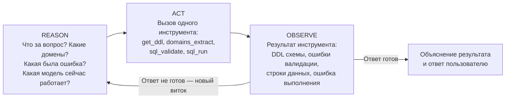
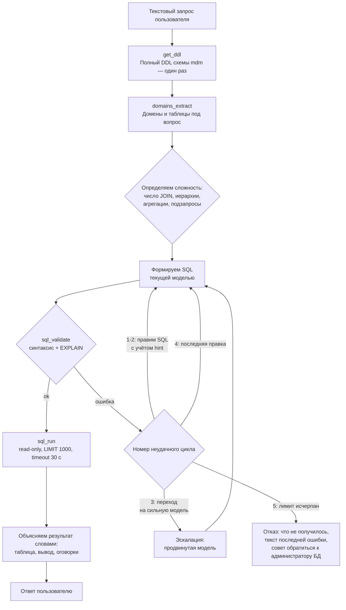

# Кейс 2. Агент аналитики данных: Text-to-SQL для базы MDM

## 1. Паспорт кейса

| | |
|---|---|
| 🧩 Проблема | Доступ к мастер-данным (MDM) — через ручные SQL-запросы: аналитик ждёт разработчика или сам пишет SQL, анализ замедляется |
| ⚙️ Почему нужен агент | Требуется упростить получение данных и сократить время на аналитику: от вопроса на русском до готовой таблицы — минуты, без знания SQL и схемы |
| 🤖 Что он делает | Принимает текстовый запрос → формирует SQL → выполняет его к базе данных → объясняет результат человеческим языком |

## 2. Предметная область: MDM организации

Система управления мастер-данными (Master Data Management) организации. СУБД — PostgreSQL, одна схема `mdm`. Агент работает от имени аналитиков master-data отдела: у них полный доступ на чтение ко всем таблицам, многоуровневой изоляции нет.

| Домен | Таблицы | Содержимое |
|---|---|---|
| Организации и контрагенты | `organizations`, `counterparties` | Свои юрлица; внешние контрагенты (ИНН, КПП, статус, дата регистрации) |
| Договоры | `contracts`, `contract_types` | Договоры: номер, даты, сумма, валюта, статус; связь «контрагент ↔ наша организация» |
| Пользователи и доступ | `users`, `departments`, `roles` | Сотрудники (email, должность, признак активности, последний вход); иерархия отделов; роли доступа |
| Товары | `products`, `product_categories`, `units` | SKU (артикул, название, категория, единица измерения, статус); иерархия категорий; справочник единиц (шт, кг, уп) |
| Качество данных | `duplicate_candidates`, `mdm_audit_log` | Пары-кандидаты в дубликаты (совпадение ИНН/наименования); журнал изменений мастер-данных (кто, что, когда) |

Примеры реальных вопросов аналитика:

1. «Сколько активных контрагентов имеют одинаковый ИНН — покажи пары».
2. «Топ-10 отделов по числу сотрудников, с названием родительского подразделения».
3. «Какие пользователи с ролью "Администратор" не заходили больше 90 дней?»
4. «Посчитай SKU по категориям с развёрткой иерархии категорий до корня».
5. «Какие записи о контрагентах менял пользователь Иванов за последнюю неделю?»

Пример того, что возвращает `get_ddl` (фрагмент):

```sql
CREATE TABLE mdm.counterparties (
    id          bigserial PRIMARY KEY,
    inn         varchar(12) NOT NULL,       -- ИНН
    kpp         varchar(9),                 -- КПП
    name        text NOT NULL,              -- наименование
    status      varchar(20) NOT NULL,       -- active | closed | suspended
    registered_at date,
    created_at  timestamptz DEFAULT now()
);
CREATE INDEX idx_counterparties_inn ON mdm.counterparties (inn);
```

## 3. Цикл работы агента: Reason → Act → Observe

Агент — не «один запрос к модели», а цикл витков. На каждом витке:

- **Reason** — модель рассуждает: что за вопрос, какие домены затронуты, что ответил предыдущий инструмент, какая ошибка и как её исправить, не пора ли эскалировать модель;
- **Act** — вызов ровно одного инструмента (см. §4);
- **Observe** — агент смотрит на результат: строки схемы, ошибки валидации, данные, ошибку выполнения — и решает, готов ли ответ.



Объяснение результата — не инструмент: его делает сама модель по полученным строкам.

## 4. Инструменты (тулсы)

| Инструмент | Параметры | Возвращает | Лимит |
|---|---|---|---|
| `get_ddl` | — | Полный DDL схемы `mdm`: таблицы, колонки, типы, ключи, индексы, комментарии | 1 вызов на диалог, дальше DDL живёт в контексте |
| `domains_extract` | `question`, `top_k` | Домены и таблицы, релевантные вопросу, с обоснованием: `[{domain, tables, confidence, evidence}]` | ≤ 2 на вопрос |
| `sql_validate` | `sql` | `ok` либо ошибку `{code, message, hint}` и стоимость по `EXPLAIN`; запрос не выполняется | Каждый виток формирования SQL |
| `sql_run` | `sql`, `limit`, `timeout_s` | Строки результата и метаданные выполнения | Только после `ok` от `sql_validate`, ≤ 2 на вопрос |

Коды ошибок `sql_validate` (по ним модель исправляет запрос):

| Код | Значение |
|---|---|
| `SYNTAX_ERROR` | Синтаксическая ошибка SQL — сообщение и позиция от парсера |
| `UNKNOWN_TABLE` / `UNKNOWN_COLUMN` | Таблица или колонка не найдена в DDL — hint предлагает ближайшие из схемы |
| `NOT_SELECT` | Запрос не является `SELECT` — выполнение запрещено |
| `PLAN_TOO_EXPENSIVE` | Стоимость по `EXPLAIN` выше порога — hint подсказывает фильтр или индекс |
| `LIMIT_MISSING` | Нет `LIMIT` — агент добавляет принудительно |

## 5. Схема работы: DDL → домены → цикл генерации SQL

Порядок шагов фиксированный: сначала вытаскиваем полный DDL схемы, затем выделяем домены из вопроса пользователя, затем цикл «определяем сложность → формируем SQL → проверяем корректность». После третьего неудачного цикла переходим на более сложную модель; всего не более пяти циклов, затем честный отказ.



Как устроены шаги:

- **Определяем сложность.** Дешёвая оценка по доменам и вопросу: число таблиц и JOIN, наличие иерархий (рекурсивные CTE для `product_categories` и `departments`), оконные функции, неоднозначности. Оценка не выбирает модель напрямую — она определяет стратегию генерации (простой SELECT или разложение на CTE) и попадает в промпт модели.
- **Формируем SQL.** Циклы 1–2 — базовая (дешёвая) модель. Ей передаются вопрос, релевантный фрагмент DDL и текст прошлой ошибки с hint.
- **Проверяем корректность.** `sql_validate` гоняет синтаксический разбор и `EXPLAIN` без выполнения. Ошибка возвращается структурированным кодом и подсказкой — это наблюдение (Observe) для следующего витка.
- **Эскалация.** После 3-й неудачи цикл продолжает продвинутая модель: ей передаётся вся история попыток и ошибок. Циклы 4–5 — её бюджет. После 5-й неудачи агент отказывается и объясняет почему.
- **Выполнение и объяснение.** Успешный запрос выполняется `sql_run` (read-only, принудительный `LIMIT`, таймаут), затем модель объясняет результат: что посчитано, какие допущения сделаны, на что посмотреть внимательнее.

## 6. Ограничения и безопасность 🔒

- **Read-only на уровне БД.** Отдельный пользователь PostgreSQL только с `GRANT SELECT` на схему `mdm`. DDL/DML невозможны даже при ошибке агента — их отсекает и сама база, и проверка `NOT_SELECT`.
- **Ограниченный доступ к данным.** Агент видит только схему `mdm`; зарплатные и прочие чувствительные таблицы в неё не входят. Персональные данные `users` (email, ФИО) доступны аналитикам master-data по праву роли — агент не расширяет доступ, а лишь использует существующий.
- **Принудительные лимиты.** `LIMIT ≤ 1000` строк добавляется автоматически; `statement_timeout = 30 с`; тяжёлые планы отсекаются до выполнения по стоимости `EXPLAIN` (`PLAN_TOO_EXPENSIVE`).
- **Безопасное выполнение.** Порядок строгий: `sql_validate` → только при `ok` → `sql_run`. Параметры фильтров (даты, ИНН) передаются связанными параметрами, а не конкатенацией строк.
- **Аудит.** Каждый сгенерированный запрос пишется в журнал агента вместе с вопросом пользователя, номером цикла и результатом — можно разобрать любой ответ постфактум.

## 7. Сложности ⚠️ и как с ними работает агент

| Сложность | Пример | Ответ агента |
|---|---|---|
| Неоднозначные формулировки | «организации» — это свои юрлица (`organizations`) или контрагенты (`counterparties`)? | `domains_extract` возвращает домены с `confidence`; при низкой уверенности агент задаёт один уточняющий вопрос вместо угадывания |
| Бизнес-жаргон ≠ имена таблиц | «товары», «SKU», «номенклатура» — всё это `products` | Комментарии в DDL и словарь синонимов в промпте; hint у `UNKNOWN_TABLE` предлагает ближайшие имена |
| Сложные связи между таблицами | Договор связывает контрагента и нашу организацию; категории и отделы — иерархии | Оценка сложности на витке: иерархии раскладываются в рекурсивные CTE, многоэтапные расчёты — в цепочку CTE вместо вложенных подзапросов |
| Тонкости агрегации | «сколько контрагентов» — строк или уникальных ИНН? | Агент проговаривает допущение в объяснении результата («посчитаны уникальные ИНН») |
| Ошибки генерации | Несуществующая колонка `is_active` вместо `status` | Коды ошибок с hint + бюджет из 5 циклов + эскалация на сильную модель после 3-го |

## 8. Пример работы (один прогон)

Вопрос: **«Сколько активных контрагентов имеют одинаковый ИНН — покажи пары»**.

1. **Reason/Act:** DDL уже загружен в контекст диалога. `domains_extract` → домен «Контрагенты», таблица `counterparties`, уверенность высокая.
2. **Цикл 1 (дешёвая модель):** сформирован SQL с `WHERE is_active = true`. `sql_validate` → `UNKNOWN_COLUMN`, hint: «нет колонки `is_active`, ближайшая — `status`».
3. **Цикл 2:** SQL исправлен на `WHERE status = 'active'`, `GROUP BY inn HAVING count(*) > 1`, добавлен `LIMIT 1000`. `sql_validate` → `ok`, план приемлемый. `sql_run` → 17 пар ИНН.
4. **Объяснение:** «Найдено 17 ИНН, по которым зарегистрировано более одного активного контрагента (всего 36 записей). Пары вероятных дубликатов уже собраны в `duplicate_candidates` — стоит начать с них. Учтите: считались уникальные ИНН среди контрагентов со статусом "active"».

Итог: две итерации, до эскалации не дошло.

## 9. Допущения

- Схема `mdm` условная, придумана в рамках учебного задания; имена таблиц и колонок примерные.
- СУБД — PostgreSQL 15, объёмы до миллионов строк на таблицу.
- Бюджет: циклы 1–2 — базовая (дешёвая) модель, после 3-й неудачи — продвинутая модель, жёсткий потолок 5 циклов, затем отказ с объяснением.
- Уточняющий вопрос пользователю допускается один и только при низкой уверенности `domains_extract`; в остальных случаях агент делает допущение и проговаривает его в ответе.
